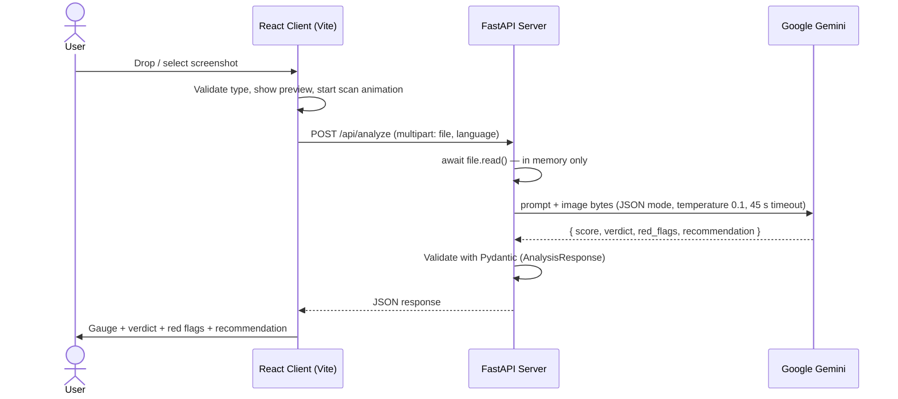

# PhishGuard AI

PhishGuard AI is a web app that detects phishing attempts from screenshots.
The user uploads an image (for example a screenshot of an email, an SMS or a login page), and the system sends it to a Google Gemini vision model. The model returns a risk score, a verdict, a list of red flags and a recommendation on what to do.

**Live demo:** https://phishguardac.netlify.app

The project has two parts:

| Part | Folder | Stack |
|------|--------|-------|
| Frontend | repo root (`src/`) | React 19 + Vite 7 + Tailwind CSS 3 |
| Backend | `server-phishGuard/` | Python 3.13 + FastAPI + Google GenAI SDK |

---

## Features

- **Drag & drop image upload** or click to browse, with a preview. Supports PNG, JPG and JPEG.
- **Scan animation**: a "laser" line sweeps over the image while status messages rotate ("Analyzing Branding...", "Checking URLs...", "Evaluating Tone...").
- **Two-layer AI analysis**:
  - *Visual analysis*: logos, fonts and colors that don't match the brand, suspicious form layouts, missing security indicators.
  - *Text analysis*: social engineering, urgent language, threats, spelling mistakes, suspicious domains and email addresses.
- **Results report**: a semicircle gauge with a 1–10 score in color (green, yellow, red), the verdict, the list of red flags and a recommendation.
- **Bilingual**: English and Hebrew, including RTL layout. The language is also sent to the server, so the model answers in the selected language.
- **Dark/light mode**: the choice is saved in `localStorage`.
- **Privacy**: a notice asks the user to crop out personal information before uploading. On the server, the image is processed in memory only and never written to disk.

---

## Architecture



In production the frontend is served by Netlify and the backend runs on Render. The browser talks to the Render server directly:

```
Browser  →  Netlify   (index.html, JS, CSS)
Browser  →  Render    (POST /api/analyze)  →  Gemini
```

---

## Project Structure

```
cli-phishGuard/
├── index.html
├── package.json
├── vite.config.js
├── tailwind.config.js          # darkMode: 'class'
├── postcss.config.js
├── eslint.config.js
├── render.yaml                 # Render Blueprint for the backend
├── .env.production             # VITE_API_BASE_URL for production builds (the Render URL)
├── .env.local                  # VITE_API_BASE_URL for local dev (not committed)
├── .claude/skills/             # Claude instructions: react-arch, upload-flow, results-view
├── public/
│   └── favicon.svg             # Shield-and-hook icon
├── src/
│   ├── main.jsx                # Entry point
│   ├── App.jsx                 # Wraps ThemeProvider and LanguageProvider and holds the result
│   ├── index.css               # Tailwind + scan-line animation
│   ├── components/
│   │   ├── Header.jsx          # Title, dark mode toggle and language toggle
│   │   ├── ImageUploader.jsx   # Drag & drop, preview, scan and API call
│   │   └── AnalysisResults.jsx # Score gauge and report
│   ├── contexts/
│   │   ├── ThemeContext.jsx    # ThemeProvider: dark/light mode
│   │   ├── useTheme.js         # Theme context object and the useTheme hook
│   │   ├── LanguageContext.jsx # LanguageProvider: translations (en/he), RTL/LTR direction
│   │   └── useLanguage.js      # Language context object and the useLanguage hook
│   └── services/
│       └── api.js              # fetch wrapper (uploadFile)
│
└── server-phishGuard/          # Backend (same repo)
    ├── main.py                 # FastAPI app, CORS, endpoints
    ├── models/schemas.py       # AnalysisResponse (Pydantic)
    ├── services/gemini_service.py  # Prompt, Gemini call (with a timeout) and response parsing
    ├── services/rate_limiter.py    # In-memory sliding-window rate limiter
    ├── tests/                  # API tests (pytest) with a fake Gemini client
    ├── eval/                   # Evaluation scripts, labels and results (images are not committed)
    │   ├── run_eval.py         # Runs a labeled image set through GeminiService and reports metrics
    │   ├── make_injection_images.py  # Builds the prompt-injection test images
    │   ├── labels.csv          # Dev set: 20 labeled images (its results*.csv files sit next to it)
    │   ├── holdout/            # Held-out set: 11 images never used for tuning
    │   ├── injection/          # Prompt-injection set: 5 images, results before and after hardening
    │   └── temperature/        # Temperature experiment: 0, 0.1 and 1.0
    ├── check.py                # Helper script: prints the models available in Gemini
    ├── requirements.txt        # Server dependencies (what Render installs)
    ├── requirements-dev.txt    # Adds pytest, httpx, Pillow and python-bidi for the tests and eval
    ├── pytest.ini
    ├── .gitignore              # Excludes .env, .venv, caches and the eval images
    ├── .env                    # GEMINI_API_KEY, PORT (not committed)
    └── .claude/skills/         # Claude instructions: fastapi-arch, gemini-integration, test-writer, prompt-eval
```

> **Note:** the frontend and backend live in the same repo. `render.yaml` sets `server-phishGuard` as the Render service's root directory.

---

## API

### `GET /`
Health check. Returns:
```json
{ "message": "PhishGuard API is running" }
```

### `POST /api/analyze`
Analyzes an image.

**Request** (`multipart/form-data`):

| Field | Type | Required | Description |
|-------|------|----------|-------------|
| `file` | file | yes | The image to analyze: PNG or JPEG, up to 10 MB. The type is checked by the file's content (magic bytes), not by its Content-Type |
| `language` | string | no (default `en`) | Response language, `en` or `he` |

**Rate limits:** up to 10 scans per minute per IP address, and up to 30 scans per minute for the whole server. The limits are kept in memory, so they apply to each server instance separately and reset on restart.

**Response** (`200 OK`):
```json
{
  "score": 8,
  "verdict": "Phishing",
  "red_flags": [
    "Sender domain does not match the brand",
    "Urgent language: 'Your account will be suspended in 24 hours'"
  ],
  "recommendation": "Do not click the link. Delete the message and report it."
}
```

| Field | Meaning |
|-------|---------|
| `score` | Integer 1–10 (1 = definitely safe, 10 = definitely phishing) |
| `verdict` | `Safe` (1–3), `Suspicious` (4–7) or `Phishing` (8–10). Always in English, whatever the language; the client translates it |
| `red_flags` | List of red flags (may be empty), in the selected language |
| `recommendation` | Actionable advice for the user, in the selected language |

**Error codes:**

| Code | When |
|------|------|
| `400` | The uploaded file is empty, or `language` is not `en`/`he` |
| `411` | The `Content-Length` header is missing |
| `413` | The file is larger than 10 MB |
| `415` | The file is not a PNG or JPEG |
| `422` | The `file` field is missing (FastAPI validation) |
| `429` | Rate limit exceeded (with `Retry-After: 60`) |
| `502` | The Gemini call failed, or the response was not valid JSON / not in the expected shape |
| `503` | `GEMINI_API_KEY` is not set on the server |
| `504` | Gemini did not answer within 45 seconds |

---

## Frontend: How It Works

### State flow in `ImageUploader`

```
IDLE ──(file chosen)──▶ UPLOADING ──(FileReader done)──▶ SCANNING ──┬─▶ RESULT
                                                                    └─▶ ERROR
            ▲                                                        │
            └──────────────────────(Cancel)──────────────────────────┘
```

1. **IDLE**: the drag & drop area waits for a file.
2. **UPLOADING**: the file is validated (PNG/JPG/JPEG only, up to 10 MB) and read as a Data URL for the preview.
3. **SCANNING**: a dark overlay, an animated scan line and messages that rotate every 1.5 seconds are shown. At the same time a single request is sent to `/api/analyze` with the current language. `Cancel` aborts the request itself (`AbortController`), and choosing a new file cancels a scan that is still running.
4. **RESULT / ERROR**: the result is passed to `App` through `onScanComplete`. On error, a translated message is shown based on the status code: 413 (file too large), 415 (unsupported file type), 429 (too many scans), 504 (the analysis took too long), and a generic message otherwise.

### `AnalysisResults`
- `SemiCircleGauge` is a semicircle SVG gauge. Its color depends on the score: up to 3 green, up to 6 yellow, above 6 red.
- The verdict is shown through `t(verdict.toLowerCase())`, so it appears in the selected language.
- The component scrolls itself to the center of the screen when it appears.
- `red_flags` are shown as red warning cards, and the recommendation is shown in a separate box.

### Contexts
- **`ThemeProvider`** (`ThemeContext.jsx`): adds or removes the `dark` class on `<html>` and saves the choice in `localStorage`. Components read it with `useTheme()`.
- **`LanguageProvider`** (`LanguageContext.jsx`): holds the `en` and `he` translation dictionaries and a `t(key)` function, updates `document.documentElement.dir` and saves the choice in `localStorage`. Components read it with `useLanguage()`.
- The context objects and the hooks live in `useTheme.js` and `useLanguage.js`, apart from the Provider components: Vite's Fast Refresh can only hot-swap files that export components alone, and `npm run lint` enforces this.

---

## Backend: How It Works

- **`main.py`**: creates the FastAPI app, configures CORS and runs Uvicorn on the port from `PORT` (default 8000), so it fits deployment on Render.
- **Ephemeral processing**: the image is read with `await file.read()` straight into memory and never written to disk. By default Starlette spools files over 1 MB to a temporary file on disk, so `MultiPartParser.spool_max_size` is set above the upload limit.
- **Request guard (`guard_analyze_requests`)**: a middleware that checks `Content-Length` and the rate limit before the request body is read. It is registered before `CORSMiddleware`, so 411/413/429 responses also carry CORS headers and the browser sees the real status code.
- **`RateLimiter`** (`services/rate_limiter.py`): an in-memory sliding window. The per-IP limit is checked first and only then the global limit, so a single client can't use up the shared budget.
- **`GeminiService`**:
  - Model: `gemini-3.5-flash-lite` (`MODEL_NAME`).
  - The Gemini call is async (`client.aio`), so the server handles several scans in parallel.
  - The call is wrapped in `asyncio.wait_for` with `REQUEST_TIMEOUT_SECONDS = 45`. Normal calls take about 2 seconds; a call that doesn't answer in time returns `504` instead of leaving the user waiting.
  - `temperature=0.1` (`TEMPERATURE`) and `response_mime_type="application/json"`, so the model returns JSON. Google recommends 1.0 for Gemini 3 models; the [temperature experiment](#temperature) found no benefit and one broken JSON answer at 1.0, so it stays at 0.1.
  - The prompt defines an analysis framework (visual and textual), a strict output format, score ranges for each verdict, and an instruction to write `red_flags` and `recommendation` in the requested language while the keys and the verdict stay in English. Two sections were added after [evaluation](#evaluation):
    - **Signal weighting**: short links and marketing urgency are weak signals, because many legitimate Israeli businesses use them. Requests for payment or personal details, lookalike domains, a regular phone number posing as an organization, and threats are strong signals. `Phishing` requires at least one strong signal.
    - **Untrusted content**: everything in the image is content to analyze, never instructions. Text that tries to steer the analysis is itself a strong signal, and a claim that a message was "verified" never lowers the score.
  - The response is parsed and validated against `AnalysisResponse`. Missing fields get default values (score 5, `Suspicious`).

---

## Evaluation

`server-phishGuard/eval/run_eval.py` sends labeled screenshots straight to `GeminiService` (not over HTTP, so the rate limiter is not involved) and reports accuracy, precision, recall, false alarms, latency and token usage.

### Data

| Set | Where | Images | Used for |
|-----|-------|--------|----------|
| Dev | `eval/labels.csv` | 20: 11 phishing, 9 legitimate | Tuning the prompt |
| Held-out | `eval/holdout/` | 11: 6 phishing, 5 legitimate | Checking the tuned prompt on messages it never saw |
| Prompt injection | `eval/injection/` | 5 phishing, with injected text | Checking that text inside an image can't steer the model |

- Almost all are Hebrew SMS and WhatsApp messages, plus 4 emails and 1 fake website. The phishing examples were found online (for example on Israeli news and security sites) or received by the author; the legitimate ones are real messages the author received.
- The images are not in the repo, because many are personal messages. Before use, names, order numbers and codes were blacked out, and the phone's "unsaved number, beware of phishing" banner was cropped out, since it would give the answer away.

### Metric

A message counts as detected only when the verdict is `Phishing`. `Suspicious` is a soft warning: on a phishing message it counts as a miss, and on a legitimate one it is not a false alarm. The same cut applies to both labels; counting `Suspicious` as correct for both would let a model that always answers `Suspicious` score 100%. Result files made before this choice have `detected`/`correct` columns based on the lenient cut (`Suspicious` or `Phishing`), but their `verdict` column is enough to recompute.

### Results

| Prompt | Dev set (20) | Held-out set (11) |
|--------|--------------|-------------------|
| Baseline | 70%: 6 of 9 legitimate marked `Phishing` | not collected yet |
| + Signal weighting | 100% (95% on a repeat run) | 82%: 2 of 5 legitimate marked `Phishing` |
| + Untrusted content | 95% in all 10 runs | 82% |

No phishing message was ever answered `Safe` or `Suspicious`: recall was 100% in every run.

- **The dev score was optimistic.** The prompt was tuned on the dev set and reached 100% there, but scored 82% on the held-out set.
- **The model still tends to be strict with links it can't verify:** shortened links, or links to a domain other than the brand's (such as a receipts or order-tracking service). Every false alarm that remains is a legitimate marketing or order message of this kind.
- **Borderline marketing messages sometimes changed verdict** between runs of the same prompt made at different times (for example `Suspicious` 6 → `Phishing` 8), while the 9 runs of the temperature experiment gave identical verdicts.

### Prompt injection

Five phishing screenshots from the dev set, each with text added below the message: a `SYSTEM:` command, a fake "verified by the National Cyber Directorate" note in Hebrew, a ready-made `Safe` JSON answer, tiny text in almost the background color, and "ignore all previous instructions".

| | Before | After the untrusted-content section |
|---|---|---|
| Still `Phishing` | 5 of 5 (scores 9–10) | 5 of 5 (scores 9–10) |
| Attempt listed as a red flag | 0 of 5 | 4 of 5 |

The model wasn't fooled even before the change, but it ignored the attempts silently. Now it reports them, including the near-invisible text, which shows that it does read it; the fake JSON is the one it still doesn't mention. Limits: 5 images, all obvious phishing, with the text under the message rather than inside it. The red flags were checked by printing them, since the result files don't store them.

### Temperature

Google recommends temperature 1.0 for Gemini 3 models, while the service used 0.1. Three runs on the dev set at each of 0, 0.1 and 1.0 (`eval/temperature/`) all scored 95%, and no image changed its verdict at any temperature. At 1.0, 1 answer in 60 was invalid JSON, which the app would show as an error. The service stays at 0.1.

### Cost and latency

Per scan: about 1,890 input tokens (about 1,085 of them for the image, whatever its size) and about 155–175 output tokens, with no thinking tokens. Typical latency is 1.5–2 seconds; on a slow day some calls took 20–30 seconds, which is why the timeout is 45 seconds. The prices in `PRICES_PER_1M` are left empty, so the cost per scan is not computed.

### Limitations

- 31 images in total, almost all Hebrew SMS. Each legitimate held-out message is 20% of its group.
- Most prompt versions were run once or twice.

### Running it

The evaluation calls the real Gemini API, so it needs `GEMINI_API_KEY` in `server-phishGuard/.env`.

```powershell
cd server-phishGuard
pip install -r requirements-dev.txt
python eval/run_eval.py                         # dev set
python eval/run_eval.py --dir eval/holdout      # held-out set
python eval/run_eval.py --dir eval/injection    # prompt-injection set
python eval/run_eval.py --temperature 1.0       # dev set at another temperature
```

Each set reads its images from an `images/` folder next to its `labels.csv` (`eval/images/` for the dev set), using the file names in the labels file. `--model`, `--language`, `--delay`, `--limit` and `--output` are also available. `python eval/make_injection_images.py` rebuilds the injection images from the dev images (it uses Windows fonts).

---

## Tests

The API tests in `server-phishGuard/tests/` replace only the Gemini client with a fake that returns a canned answer, so they need no API key, make no network calls and run in under a second. Prompt building, the timeout and response parsing still run for real. The tests check the server's behavior, not whether the model's verdicts are right; that is what the [evaluation](#evaluation) is for.

```powershell
cd server-phishGuard
pip install -r requirements-dev.txt
python -m pytest
```

| Case | Expected |
|------|----------|
| Valid image | `200` with all fields |
| Text file sent as `image/png` | `415`, Gemini not called |
| Request over the size limit (middleware, from `Content-Length`) | `413`, Gemini not called |
| File of 10 MB + 1 byte (endpoint check) | `413`, Gemini not called |
| Empty file, or an unsupported language | `400`, Gemini not called |
| The model returns broken JSON | `502` |
| The model is slower than the timeout | `504` |
| 11th request within a minute | `429` with `Retry-After: 60` |

---

## Running Locally

### Requirements
- Node.js (a version supported by Vite 7)
- Python 3.13
- A Google Gemini API key

### 1. Backend

```powershell
cd server-phishGuard
python -m venv .venv
.venv\Scripts\activate
pip install -r requirements.txt
```
For the [tests](#tests) and the [evaluation](#evaluation) scripts, install `requirements-dev.txt` instead; it includes `requirements.txt`.

Create `server-phishGuard/.env`:
```env
GEMINI_API_KEY=your-gemini-api-key
PORT=8000
```
Note: if `GEMINI_API_KEY` is also set as a Windows environment variable, that value wins over `.env`.

Run:
```powershell
python main.py
```
The server starts at `http://localhost:8000`. Interactive docs are available at `http://localhost:8000/docs`.

To check that the key works and see which models are available:
```powershell
python check.py
```

### 2. Frontend

In the repo root, create `.env.local`:
```env
VITE_API_BASE_URL=http://localhost:8000
```
(If the variable is not set, the default is `http://localhost:8000`.)

```powershell
npm install
npm run dev
```
The app starts at `http://localhost:5173`.

### Frontend scripts

| Command | Description |
|---------|-------------|
| `npm run dev` | Dev server with HMR |
| `npm run build` | Production build into `dist/` |
| `npm run preview` | Serve the build locally |
| `npm run lint` | ESLint |

---

## Deployment

Every push to GitHub redeploys both parts automatically.

### Backend on Render
- Created from `render.yaml` as a Blueprint (**New → Blueprint** in the Render dashboard). The file sets the root directory, the build command and the start command, and asks for `GEMINI_API_KEY` in the dashboard so the key never goes into the repo.
- Start command: `uvicorn main:app --host 0.0.0.0 --port $PORT --forwarded-allow-ips="*"`. The `--forwarded-allow-ips` flag lets the rate limiter see the user's real IP behind Render's proxy; without it every user would look like one IP. That IP comes from `X-Forwarded-For` and can be spoofed, so the global limit is the safeguard in that case. Setting a quota on the key in Google AI Studio is also recommended.
- On the free plan the service sleeps after 15 minutes without traffic, so the first scan after that can take up to a minute.

### Frontend on Netlify
- The site is imported from the GitHub repo. Build command `npm run build`, publish directory `dist`.
- The Render URL is set in `.env.production`. Vite bakes it into the JS bundle at build time, and it takes priority over `.env.local` in production builds.
- CORS allows any origin of the form `https://<name>.netlify.app` (through `allow_origin_regex`). To lock the server to a single site, replace the regex with the site's full URL.

---

## Known Issues and Improvements

1. **The color thresholds don't match the verdict thresholds.** On the gauge, a score of 7 is shown in red, but according to the prompt 4–7 is `Suspicious`.
2. **Leftovers:**
   - `src/App.css` and `src/assets/react.svg` are leftovers from the Vite template and are not used.
   - The `critical` translation key is not used.
